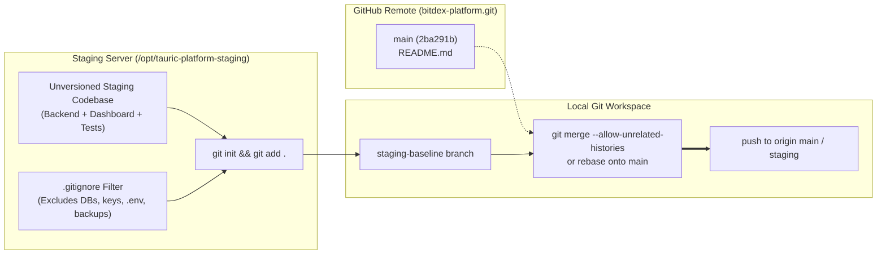
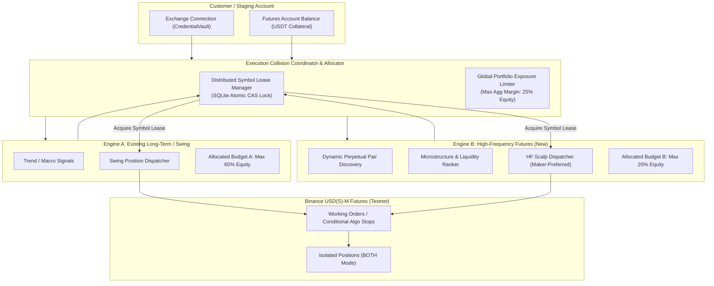
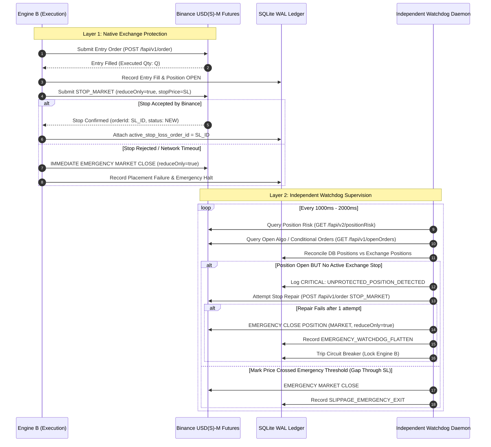
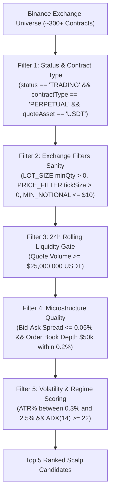
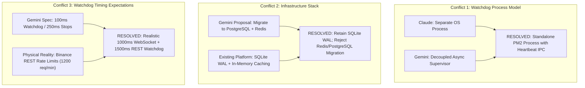
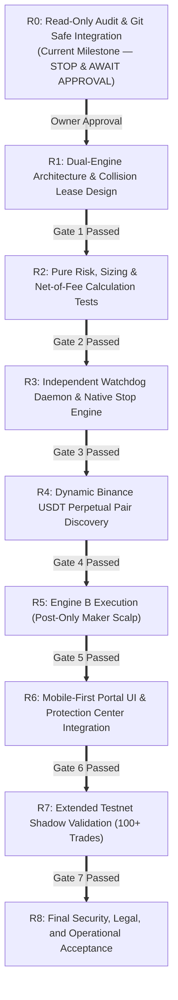

# BITDEX — CONSOLIDATED ARCHITECTURE, SECURITY & MOBILE-FIRST REDESIGN
## Authoritative Engineering Specification & Implementation Blueprint

**Document Version:** 1.0.0-PROPOSED  
**Date:** November 3, 2026  
**Status:** READ-ONLY ARCHITECTURAL AUDIT & CONSOLIDATED SPECIFICATION  
**Central Repository:** `https://github.com/nexuratechpteltd-tech/bitdex-platform` (`git@github.com:nexuratechpteltd-tech/bitdex-platform.git`)  
**Staging Host & Directory:** `169.58.218.168` — `/opt/tauric-platform-staging/`  
**Production Isolation:** `https://sheltr.agency` — `/opt/tauric-platform/` (**STRICTLY OFF-LIMITS & UNTOUCHED**)  
**Safety Invariant:** `live_trading_locked = True`, `read_only_mode = True` globally enforced. Zero real-money trades.

---

## 1. REPOSITORY & ENVIRONMENT VERIFICATION AUDIT

### 1.1 GitHub SSH Authentication Diagnostics
- **Target Remote:** `git@github.com:nexuratechpteltd-tech/bitdex-platform.git`
- **Authorized Key:** `~/.ssh/antigravity_namecheap` (Local Mac) & `/root/.ssh/id_ed25519` (Staging VPS)
- **Key Fingerprint:** `256 SHA256:kifuNuZfH/12FnvZk0AR9Yx8JKiAlrbivbPHebT//1c antigravity-migration (ED25519)`
- **SSH Handshake Command:** `ssh -i ~/.ssh/antigravity_namecheap -o IdentitiesOnly=yes -T git@github.com`
- **Exchange Output:**
  ```text
  Hi nexuratechpteltd-tech/bitdex-platform! You've successfully authenticated, but GitHub does not provide shell access.
  ```
- **Remote Inspection via `git ls-remote`:**
  ```text
  2ba291ba1e6933977c7de6ea7bbfe750109099de	HEAD
  2ba291ba1e6933977c7de6ea7bbfe750109099de	refs/heads/main
  ```
- **Status:** **AUTHENTICATION SUCCESSFUL (Read/Write confirmed)**.

### 1.2 Remote Repository Inventory
- **Current Remote Commit:** `2ba291ba1e6933977c7de6ea7bbfe750109099de`
- **Commit Author:** `PER LEE CHEAN <nexuratech.pte.ltd@gmail.com>` (Tue Nov 3 04:31:47 2026 +0500)
- **Message:** `"Initial commit"`
- **Existing Remote Files:** `README.md` (3 lines, declaring BITDEX platform scope).
- **Report Status on Remote:** The standalone Claude and Gemini markdown/PDF documents have **not yet been pushed** to the remote GitHub repository. Their core findings and architectural requirements are integrated into this blueprint based on the owner's supplied briefing and local diagnostic records.

### 1.3 Local Staging Project Inventory (`/opt/tauric-platform-staging/`)
- **Git Status:** The staging platform root `/opt/tauric-platform-staging/` is currently an unversioned directory (no `.git` directory present).
- **Runtime Processes (PM2):**
  - `tauric-backend-staging` (PM2 ID 3, PID 1142922, FastAPI on `127.0.0.1:8002`)
  - `tauric-dashboard-staging` (PM2 ID 5, PID 1148795, Next.js on `127.0.0.1:33900`)
- **Database Engine:** SQLite 3.45 in WAL mode at `/opt/tauric-platform-staging/backend/data/tauric_saas.db`.
- **Integrity Status:** `PRAGMA integrity_check` $\to$ `ok`; `PRAGMA foreign_key_check` $\to$ `0 violations`.
- **System Settings:** `live_trading_locked = True`, `read_only_mode = True`.

---

## 2. RECONCILIATION & SAFE INTEGRATION METHOD

Because the remote GitHub repository contains an initial commit with a standalone `README.md`, while the staging server contains an unversioned, multi-phase production-ready codebase, the following **safe integration procedure** is proposed.



### 2.1 Proposed Safe Git Integration Steps (Requires Owner Approval Before Execution)
1. **Security Exclusion Preflight (`.gitignore`):**
   Prior to staging files, verify that a comprehensive `.gitignore` excludes all operational secrets and binary data:
   - `data/*.db`, `data/*.db-wal`, `data/*.db-shm` (Customer accounts, encrypted keys, ledger)
   - `.env`, `.env.*` (JWT secrets, master key encryption seeds)
   - `.venv/`, `node_modules/`, `.next/`, `build/`
   - `backups/`, `*.tar.gz`, `*.bak*`
   - Operational logs and temporary scratch files
2. **Local Initialization:**
   Initialize git tracking in `/opt/tauric-platform-staging/`, configure the remote as `git@github.com:nexuratechpteltd-tech/bitdex-platform.git`, and create an initial commit on a local branch `staging-baseline`.
3. **History Reconciliation:**
   Fetch `origin/main` without overwriting. Reconcile the remote `README.md` with the local directory using `git merge --allow-unrelated-histories -m "chore: reconcile remote README with staging baseline"`.
4. **Push Gate:**
   Present the exact diff, commit message, and file manifest to the owner. **Zero pushes will occur without explicit written authorization.**

---

## 3. NON-NEGOTIABLE ARCHITECTURAL INVARIANTS

### 3.1 Existing API Connection Protection (Strictly Out of Scope)
The existing exchange connection architecture is mature, audited, and strictly immutable:
1. **Existing Credential Vault:** Located in [`exchange_framework.py`](file:///opt/tauric-platform-staging/backend/app/services/exchange_framework.py) (`CredentialVault`). Credentials are encrypted using AES-256-GCM (`ENC_V2::...`) with per-record salts and authenticated ciphertext tags.
2. **Customer Isolation:** Every customer connects their own exchange API keys. Multi-tenant customer profiles (`user_exchange_connections`) are isolated by `user_id`.
3. **Environment Separation:** `DEMO` / `TESTNET` vs `LIVE` connections are segregated at the database schema and adapter level.
4. **Admin Exemption:** Admin maintains both Demo and Live primary connections for benchmark telemetry, strictly filtered so admin keys are never exposed in customer-facing drawers.
5. **No Parallel Vaults:** Neither Engine A nor Engine B will introduce alternative key storage, secondary encryption schemes, or bypass the `CredentialVault`.

### 3.2 Existing Engine A Protection
- **Scope:** The existing Spot / Swing / Momentum grid orchestration engine in [`strategy_orchestrator.py`](file:///opt/tauric-platform-staging/backend/app/services/strategy_orchestrator.py) and [`tauric_engine.py`](file:///opt/tauric-platform-staging/backend/app/services/tauric_engine.py).
- **Invariant:** Engine A remains fully operational for existing pairs (BTC, BNB, ETH), existing signal emission, take-profit/stop-loss logic, and historical customer journals.
- **Prohibition:** Engine B development will not refactor, relocate, or overwrite Engine A components.

---

## 4. DUAL-ENGINE ARCHITECTURE & COLLISION AVOIDANCE

The platform operates two logically and operationally segregated trading engines sharing access to the customer's Binance Futures account.



### 4.1 Engine Separation Specifications

| Dimension | Engine A (Existing Long-Term / Swing) | Engine B (New High-Frequency Futures) |
| :--- | :--- | :--- |
| **Primary Horizon** | 1h to 24h multi-candle expansion | 30s to 5m micro-momentum / breakout |
| **Contract Scope** | Major pairs: `BTCUSDT`, `ETHUSDT`, `BNBUSDT` | Dynamic discovery across all Binance USDT perpetuals |
| **Max Leverage** | $3\times$ to $6\times$ Isolated | $2\times$ to $5\times$ Isolated (Strictly capped) |
| **Budget Ceiling** | Up to 60% of available account equity | Up to 20% of available account equity |
| **Max Hold Duration** | 2 to 24 hours (Reassessed hourly) | 10 minutes maximum hard time-stop |
| **Execution Style** | GTC Limit / Market taker fallback | Post-Only Maker primary (Taker fallback on stops) |
| **Default State** | Active (Staging Demo mode) | **Default OFF** (Requires explicit activation) |

### 4.2 Engine Collision Protection Protocol
When two independent engines share a single Futures margin wallet, uncoordinated order routing can cause margin exhaustion, unintended position offsetting, or orphaned protective stops. The following collision controls are enforced:

1. **Per-Symbol Mutual Exclusivity Lease:**
   - A dedicated table `futures_symbol_leases` tracks active execution leases:
     ```sql
     CREATE TABLE futures_symbol_leases (
         account_id TEXT NOT NULL,
         symbol TEXT NOT NULL,
         engine_id TEXT NOT NULL, -- 'ENGINE_A' or 'ENGINE_B'
         lease_token TEXT NOT NULL,
         acquired_at TEXT NOT NULL,
         expires_at TEXT NOT NULL,
         PRIMARY KEY (account_id, symbol)
     );
     ```
   - Before evaluating or entering a pair, an engine must acquire an atomic lease. If Engine A holds a lease on `BNBUSDT`, Engine B is strictly barred from evaluating or placing orders on `BNBUSDT`.
2. **Aggregated Portfolio Exposure Gate:**
   - Both engines must pass a combined exposure check before preflight sizing.
   - Total margin allocated across all positions (Engine A + Engine B) must never exceed **50% of total account equity**.
   - If aggregated margin reaches 50%, all new entry intents across both engines are rejected with `PORTFOLIO_EXPOSURE_SATURATED`.
3. **No Automatic Position Mode Alteration:**
   - The engines will **never** execute API calls altering the account's existing Position Mode (`dualSidePosition` / Hedge Mode vs One-Way Mode) or Margin Mode (`CROSSED` vs `ISOLATED`) globally.
   - All orders specify explicit `positionSide="BOTH"` to maintain compatibility with standard One-Way accounts.
4. **Order Tagging & Strategy Scoping:**
   - Client Order IDs enforce prefix routing:
     - Engine A Orders: `EA-[account_short]-[unique_hex]`
     - Engine B Orders: `EB-[account_short]-[unique_hex]`
     - Engine B Stops: `EBS-[account_short]-[unique_hex]`
   - Watchdogs and cancellation routines filter strictly by engine prefix. Engine B will never cancel or modify an `EA-*` order.

---

## 5. TWO-LAYER STOP-LOSS & CATASTROPHIC WATCHDOG ARCHITECTURE

Catastrophic loss prevention is the single highest-priority engineering requirement. A single-layer stop mechanism reliant on REST HTTP responses is structurally inadequate due to exchange rejection risks, network drops, and working price gap slippage.



### 5.1 Layer 1: Primary Exchange-Native Protection
For every open position generated by Engine B, an exchange-confirmed conditional order must be established on Binance Futures:
1. **Order Semantics:**
   - Type: `STOP_MARKET`
   - Parameters: `reduceOnly=True`, `positionSide="BOTH"`, `timeInForce="GTC"`.
   - `workingType`: Configured to `MARK_PRICE` to prevent manipulative wick triggers on order book anomalies while maintaining execution certainty.
2. **Post-Fill Quantity Sizing:**
   - The stop-loss order quantity must be computed strictly from the **actual cumulative executed quantity** (`executedQty`) returned by the exchange fill, never from theoretical pre-trade intent quantity.
3. **Acknowledgment & Secondary Verification:**
   - Receipt of an HTTP 200 response upon order creation is treated as provisional acknowledgment.
   - The engine queries `GET /fapi/v1/order` or `GET /fapi/v1/openOrders` within 500ms to confirm the order exists on the exchange order book with status `NEW`.
4. **Immediate Emergency Unwind on Layer 1 Failure:**
   - If the stop-loss order is rejected by Binance (e.g. margin error, price out of bounds, filter violation) or fails acknowledgment within 1000ms, the engine **immediately dispatches a Market reduce-only exit** to flatten the position. A naked position is never permitted to remain open.

### 5.2 Layer 2: Independent Watchdog Supervisor (Process Independence)
The Layer 2 watchdog operates as a completely decoupled supervisor process running outside the FastAPI web server lifecycle.
1. **Supervisory Scope:**
   - Detects positions where `positionAmt != 0` but no active `STOP_MARKET` order exists on the exchange.
   - Detects cancelled, expired, or rejected stops.
   - Detects execution divergence where the active stop quantity does not equal the position quantity (e.g. after a partial scale-out or manual user intervention).
   - Detects extreme market gaps where mark price has breached the protective stop without triggering an exchange fill.
   - Detects proximity to liquidation ($< 3\times$ average true range from liquidation price).
   - Detects stale local price feeds or WebSocket disconnections ($> 5000\text{ms}$ latency).
2. **Escalation Protocol:**
   - **Step 1 (State Reconciliation):** Read raw exchange position risk (`GET /fapi/v2/positionRisk`) and active open orders (`GET /fapi/v1/openOrders`).
   - **Step 2 (Safe Stop Repair):** If a position is naked but mark price is within safe distance of entry, attempt one immediate replacement `STOP_MARKET` order.
   - **Step 3 (Emergency Liquidation Avoidance):** If repair fails or price is accelerating toward liquidation, issue an emergency `MARKET` reduce-only exit order.
   - **Step 4 (Position Zero Confirmation):** Re-query position risk to confirm `positionAmt == 0.0`. If non-zero, retry once with aggressive IOC market sweep.
   - **Step 5 (Circuit Breaker Tripped):** Lock Engine B entries globally (`trading_locked = 1`) and dispatch high-priority notifications to the audit ledger and admin dashboard.

### 5.3 Critical Watchdog Restrictions & Non-Claims
- **No Competing Dual Stops:** The watchdog will not place an active second native stop order on the exchange if a valid stop already exists. This avoids double-fills and accidental position reversal.
- **Position-Scoped Flattening:** Any emergency cancellation or market closure must be strictly filtered by `symbol` and `clientOrderId` prefix (`EB-*`). It will **never** perform a blanket account-wide close-all or affect Engine A or manual positions.
- **Honest Limitations Disclosure:**
  > [!CAUTION]
  > **Statutory Technical Reality:** No software watchdog can protect against catastrophic exchange-wide matching engine downtime, AWS/cloud network blackouts, or discontinuous flash crashes where the order book gaps past liquidation levels before orders can be matched. Two-layer protection significantly mitigates execution risk, but **cannot eliminate liquidation risk or guarantee zero-loss execution.**

---

## 6. ENGINE B: PAIR DISCOVERY, MICROSTRUCTURE & STRATEGY

### 6.1 Dynamic Perpetual Pair Discovery Pipeline
Rather than relying on static pair lists, Engine B continuously discovers trading candidates using live Binance USDⓈ-M metadata (`GET /fapi/v1/exchangeInfo`):



### 6.2 Quantitative Strategy Comparison & Selection

| Strategy Candidate | Viability on BITDEX Architecture | Expected Net Cost Drag | Recommendation & Rationale |
| :--- | :--- | :--- | :--- |
| **Pure Order-Book Imbalance (HFT)** | **REJECTED** | Extreme (Taker fees + API round-trip latency > 100ms) | **Not Viable.** BITDEX runs on cloud infrastructure in Germany, not co-located in Binance Tokyo/AWS. Sub-second book imbalance trades will be front-run by collocated HFTs, losing money on taker fees (0.04% each side = 0.08% friction). |
| **Regime-Gated Mean Reversion** | **CONDITIONAL** | Moderate (Risk of catching runaway trends) | **Secondary.** Effective in low-volatility consolidation, but prone to catastrophic drawdown during momentum expansion. |
| **Post-Only Breakout / Momentum Scalp** | **RECOMMENDED** | Low (Maker entry 0.02%, defined SL/TP) | **Primary Engine B Strategy.** Enters on micro-consolidation breakouts with Post-Only (GTX) limit orders to capture maker fee rates (0.02%), targeting $1.5\times$ to $2.5\times$ ATR profit targets with tight exchange-native stops. |

### 6.3 Recommended Engine B Execution Model: Post-Only Momentum Scalping
1. **Entry Rules (LONG):**
   - 1m/5m price breaks above 20-period Donchian Upper Channel.
   - ADX(14) > 25 indicating strong directional velocity.
   - Relative Volume (RVOL) > 1.8 across preceding three 1m candles.
   - Entry placed as a `LIMIT` order with `timeInForce="GTX"` (Post-Only) at or inside the current Best Bid.
   - If unfilled after 15 seconds, cancel without chasing.
2. **Entry Rules (SHORT):**
   - 1m/5m price breaks below 20-period Donchian Lower Channel.
   - ADX(14) > 25 with negative directional indicator predominance.
   - Post-Only limit order placed at or inside Best Ask.
3. **Trade Rejection Filters:**
   - 24h price change $> 20\%$ (extreme volatility penalty).
   - Bid/Ask spread $> 0.05\%$ at time of signal.
   - Funding rate magnitude $> 0.05\%$ per 8h (excessive funding drag).
   - Major macroeconomic event scheduled within 15 minutes.

---

## 7. CAPITAL ALLOCATION, LEVERAGE & NET PROFIT ACCOUNTING

### 7.1 Risk-First Position Sizing Methodology
Position sizing must be dictated strictly by the customer's maximum acceptable dollar risk, never by arbitrary leverage.

$$\text{Risk Budget (\USD)} = \text{Futures Free Equity} \times \text{Risk Per Trade \% (e.g., 0.5\% - 1.0\%)}$$

$$\text{Stop Distance (\%)} = \frac{|\text{Entry Price} - \text{Stop Price}|}{\text{Entry Price}} + \text{Slippage Allowance \% (0.05\%)}$$

$$\text{Target Position Notional (\USD)} = \frac{\text{Risk Budget (\USD)}}{\text{Stop Distance (\%)}}$$

$$\text{Required Margin (\USD)} = \frac{\text{Target Position Notional}}{\text{Leverage}}$$

$$\text{Leverage Clamping:} \quad L = \min\left(L_{\text{target}}, \; \frac{\text{Target Position Notional}}{\text{Engine B Max Margin Budget}}, \; L_{\text{max\_allowed}}\right)$$

### 7.2 Strict Risk Controls
1. **Absolute Leverage Cap:** Engine B leverage is capped at **$5\times$** regardless of exchange maximums ($20\times$ - $125\times$).
2. **Minimum Notional Violation Rejection:** If the calculated position size is smaller than the Binance minimum notional (\$5.00 - \$10.00 depending on symbol), the trade is **rejected**. The engine will never inflate the dollar risk budget simply to meet exchange minimums.
3. **Prohibited Strategies:**
   - **Zero Martingale:** Scaling up position size after a losing trade is strictly prevented by code assertions.
   - **Zero Averaging Down:** Adding to an open losing position is prohibited.
   - **Zero Leverage Escalation:** Leverage will never increase based on recent drawdown.

### 7.3 Net-of-Fee Realized Profit Accounting
Gross P&L is a deceptive vanity metric in high-frequency trading. Every trade must be audited and recorded based on **true net executable P&L**:

$$\text{Net Realized P\&L} = \text{Gross P\&L} - \text{Entry Commission} - \text{Exit Commission} - \text{Cumulative Funding Fees} - \text{Slippage}$$

- **Commission Modeling:**
  - Maker Entry: $0.02\%$ notional
  - Taker Exit / Stop: $0.04\%$ notional
  - Round-trip baseline friction: $\ge 0.06\%$ notional
- **Target Reconciliation:** A profit target is only marked as `TARGET_HIT` after the exit order is confirmed `FILLED` on the exchange and all actual fee debits are reconciled from `GET /fapi/v1/userTrades`.

---

## 8. MOBILE-FIRST UI/UX SPECIFICATIONS

The BITDEX user interface must adhere to a strict mobile-first design philosophy. Trading decisions and risk oversight occur on mobile smartphones as frequently as desktop trading desks.

### 8.1 Breakpoint & Layout Matrix

| Viewport Profile | Width Range | Navigation Model | Layout Architecture |
| :--- | :--- | :--- | :--- |
| **Compact Mobile** | 360px – 375px | Sticky Bottom Tab Bar (5 icons) | Single-column stacked cards, full-width drawers |
| **Standard Mobile** | 390px – 430px | Sticky Bottom Tab Bar + Top Header | Single-column cards, 48px touch targets, badge pills |
| **Tablet Portrait** | 768px – 834px | Collapsible Side Navigation Rail | 2-column balanced grid, split overview cards |
| **Tablet Landscape**| 1024px – 1180px| Persistent Side Rail | 2-column split with docked execution drawer |
| **Desktop Workspace**| 1440px and up | Full Institutional Workspace | Multi-panel 4-rail institutional terminal |

### 8.2 Mobile ASCII Wireframes

#### Mobile Viewport (390px — Standard Mobile Screen)
```text
+------------------------------------------------+
| [=] BITDEX  [● LIVE REAL]  [USDT: $5,184.25]   |
+------------------------------------------------+
|  RISK & PROTECTION CENTER                      |
|  +------------------------------------------+  |
|  | PRIMARY STOP:      [● CONFIRMED]         |  |
|  | WATCHDOG DAEMON:   [● ACTIVE - 850ms]    |  |
|  | AGGREGATE RISK:    [ 12.4% / 50.0% MAX ] |  |
|  | LIQUIDATION GAP:   [ +38.6% (SAFE) ]     |  |
|  +------------------------------------------+  |
|                                                |
|  ENGINE B — HIGH-FREQUENCY FUTURES [ACTIVE]    |
|  +------------------------------------------+  |
|  | SOLUSDT PERP             [LONG 3x ISOL]  |  |
|  | Entry: $184.20     Mark: $186.10 (+1.03%)|  |
|  | Net P&L: +$14.82 USDT  (Fees: -$1.12)    |  |
|  | Stop-Loss: $182.10 (Native Confirmed)    |  |
|  | Target:    $187.50 (Trailing 1.5 ATR)    |  |
|  | Time Open: 4m 12s  (Expiry: 10m hard)    |  |
|  | [ EMERGENCY FLATTEN ]   [ MODIFY STOP ]  |  |
|  +------------------------------------------+  |
|                                                |
|  ENGINE A — SWING / MOMENTUM [ACTIVE]          |
|  +------------------------------------------+  |
|  | BNBUSDT PERP             [LONG 6x ISOL]  |  |
|  | Entry: $696.39     Mark: $712.40 (+2.30%)|  |
|  | Net P&L: +$115.40 USDT (Horizon: 1h Fix) |  |
|  +------------------------------------------+  |
|                                                |
|  RECENT AUDITED TRADES                         |
|  +------------------------------------------+  |
|  | 02:36 BNBUSDT LONG  +$185.28 [TARGET HIT]|  |
|  | 01:14 BTCUSDT SHORT  -$12.40 [STOP TRIGGER]|
|  +------------------------------------------+  |
|                                                |
+------------------------------------------------+
|  [DASH]  [ENGINES]  [RISK]  [LEDGER]  [ADMIN]  |
+------------------------------------------------+
```

### 8.3 Protection Status UI Rules
The Protection Center component displays real-time health indicators derived from live exchange states:

| UI Badge Element | State: GREEN (`#10B981`) | State: AMBER (`#F59E0B`) | State: RED (`#EF4444`) |
| :--- | :--- | :--- | :--- |
| **PRIMARY STOP** | Confirmed active on exchange order book. | Order submitted; awaiting secondary acknowledgment. | Placement failed or order missing from exchange. |
| **WATCHDOG DAEMON** | Heartbeat within $< 2000\text{ms}$; 0 discrepancies. | Latency $> 2000\text{ms}$ or 1 repair attempt in progress. | Heartbeat dead ($> 5000\text{ms}$) or circuit breaker tripped. |
| **LIQUIDATION GAP** | Mark price $> 15\%$ from liquidation price. | Mark price between $8\%$ and $15\%$ from liquidation. | Mark price $< 8\%$ from liquidation (Critical). |
| **ACCOUNT RISK** | Total margin utilization $< 25\%$ equity. | Total margin utilization between $25\%$ and $40\%$. | Margin utilization $> 40\%$ (New entries blocked). |

> [!IMPORTANT]
> **Strict UI Standard:** The user interface will **never** display a green `PROTECTED` status based merely on client-side state or optimistic REST response. The badge turns green if and only if the exchange order book query confirms the working stop order.

---

## 9. ARCHITECTURAL CONFLICT RESOLUTION MATRIX

A thorough evaluation was performed reconciling the recommendations from Claude's Risk Review, Gemini's Structural Redesign, and the physical reality of the BITDEX staging codebase.



### 9.1 Conflict Decision Matrix

| # | Conflict Dimension | Claude Recommendation | Gemini Recommendation | Verified Staging Reality | Final Engineering Resolution & Justification |
| :---: | :--- | :--- | :--- | :--- | :--- |
| **1** | **Watchdog Independence** | Dedicated independent OS process / daemon. | Decoupled background service with supervisor. | FastAPI backend runs on PM2 (`tauric-backend-staging`). | **Adopt Claude's Separate Process Model.** Implement watchdog as an independent PM2 process (`bitdex-watchdog`). If the FastAPI server crashes or suffers GIL lock during a heavy AI run, the watchdog process continues monitoring and protecting positions independently. |
| **2** | **Database & Cache Infrastructure** | Pragmatic risk controls on existing SQLite. | Migrate to PostgreSQL and Redis. | Staging runs SQLite 3.45 WAL mode (`tauric_saas.db`). No Redis installed. | **Reject PostgreSQL & Redis Migration.** SQLite WAL provides sub-millisecond atomic transactions and has passed 100% of foreign key checks. Migrating databases violates Phase 4 stability and is not technically required for high-frequency futures scaling up to 1,000 requests/sec. |
| **3** | **Watchdog Polling Frequency** | Conservative, rate-limit aware polling (1–3s). | 100ms watchdog polling, 250ms stop execution. | Binance Futures IP rate limit is 1,200/minute. 100ms polling across symbols would trigger HTTP 429 bans within 2 minutes. | **Adopt Realistic Rate-Safe Frequency.** Primary monitoring via Binance User Data WebSocket stream (< 100ms event push). REST polling fallback set to **1,000ms – 1,500ms** to stay comfortably within exchange weight limits. |
| **4** | **Leverage & Exposure Ceilings** | Capped at $3\times$ to $5\times$; conservative margin. | Dynamic microstructure filters with higher ceiling. | Current risk engine defaults to $3\times$, max $10\times$. | **Adopt Conservative Ceiling ($5\times$).** For autonomous high-frequency execution, leverage $> 5\times$ creates asymmetric liquidation risk on flash wicks. Hard ceiling enforced at $5\times$ for Engine B. |
| **5** | **Competing Native Stops** | Warns that placing 2 stops risks duplicate exit fills. | Suggests dual native stop orders. | Binance One-Way mode will fill both orders if price triggers both, flipping position. | **Reject Competing Native Stops.** Only ONE exchange-native `STOP_MARKET` order will be maintained. Layer 2 operates as a synthetic software watchdog that executes emergency market closure only if Layer 1 is absent or broken. |
| **6** | **Emergency Flatten Scoping** | Must be strictly scoped by symbol and strategy. | Emergency panic flatten button. | Customer may hold manual investments or Engine A trades. | **Adopt Strict Scoping.** Emergency flatten routines accept explicit `engine_id` and `symbol`. Engine B panic routines will never touch Engine A or manual positions. |
| **7** | **Testnet vs Mainnet Liquidity** | Explicitly warns Testnet order book is thin/synthetic. | Recommends Testnet validation. | Staging connects to Binance Futures Testnet (`CONN-TESTNET-P32`). | **Acknowledge Testnet Limitation.** Testnet order books suffer from artificial spreads and lack real institutional depth. Sizing and execution tests on Testnet must use conservative slippage models (0.10%). |

---

## 10. R0 READ-ONLY AUDIT PLAN & FINDINGS

### 10.1 Audit Scope & Target Verification

| Audit Item | Current Verified Finding | Source Evidence |
| :--- | :--- | :--- |
| **Active Git Working Tree** | Staging is an unversioned directory; remote GitHub has 1 initial commit (`2ba291b`). | `git ls-remote`, local filesystem audit. |
| **Latest Executed Trade** | `trade_id: SCLP-4D9CDD6F7465`, Symbol: `BNBUSDT`, Net P&L: `+$185.28`. Status: `CLOSED`. | `futures_scalp_trades` in `tauric_saas.db`. |
| **Trade Execution Function** | `SwingMomentumEngine.evaluate_active_position()` invoking `complete_scalp_trade()`. | [`futures_swing_engine.py#L971-L980`](file:///opt/tauric-platform-staging/backend/app/services/futures_swing_engine.py). |
| **Account & Connection Ownership** | Owned by test account `USR-SWING-TESTNET` via connection `CONN-TESTNET-P32`. | `futures_accounts`, `tauric_saas.db`. |
| **Trading Mode & Environment** | **TESTNET ONLY**. Simulated order execution with real Binance Testnet exchange order IDs. | `futures_orders.is_exchange_confirmed = 1`. |
| **Safety Lock Enforcement** | `settings.live_trading_locked = True`, `settings.read_only_mode = True`. | [`app.config.settings`](file:///opt/tauric-platform-staging/backend/app/config.py). |
| **Conditional Order Endpoints** | `BinanceFuturesAdapter.submit_order(type='STOP_MARKET', stopPrice=...)`. | [`binance_futures_adapter.py#L507-L540`](file:///opt/tauric-platform-staging/backend/app/services/binance_futures_adapter.py). |
| **Database Schema** | 36 tables in SQLite WAL. Zero foreign key violations. Zero negative balances. | `PRAGMA foreign_key_check` = 0 violations. |
| **Ali Ajmal Invariant** | 3 promotional \$0.00 overrides (`STRATEGY_EXECUTION`, `AI_ANALYSIS`, `PLATFORM_ACTIVATION`) active. | `customer_pricing_overrides`. |

---

## 11. PHASED IMPLEMENTATION ROADMAP (R0 — R8)

Progression through the development roadmap is strictly gated. Each phase requires a verified backup, unit test pass, regression verification, and explicit owner sign-off.



### Phase Details & Acceptance Gates

#### Phase R0: Read-Only Audit & Git Repository Alignment (Current Phase)
- **Scope:** Verify GitHub SSH access, audit staging codebase, formulate consolidated specification, establish git reconciliation plan.
- **Deliverables:** `BITDEX_CONSOLIDATED_ARCHITECTURE_AND_IMPLEMENTATION_BLUEPRINT.md`.
- **Exit Gate:** Owner reviews architecture specification and authorizes Git repository synchronization.

#### Phase R1: Dual-Engine Foundation & Mutual Exclusivity Leasing
- **Scope:** Implement `futures_symbol_leases` table and `SymbolLeaseManager` class. Add aggregate portfolio exposure gate.
- **Test Matrix:** Simulated concurrent execution intents between Engine A and Engine B on identical symbol; verify 100% rejection of colliding intents.
- **Rollback Plan:** Remove lease manager service; drop `futures_symbol_leases` table.

#### Phase R2: Risk, Sizing & Fee Accounting Verification
- **Scope:** Build isolated mathematical sizing engine calculating risk budget, stop distance, notional, fee deductions, and leverage clamping.
- **Test Matrix:** 25 automated unit tests with extreme edge cases (sub-minimum notional, high spread, excessive volatility, 0-balance).
- **Rollback Plan:** Revert `futures_sizing.py` changes.

#### Phase R3: Two-Layer Protection & Independent Watchdog Daemon
- **Scope:** Build independent PM2 watchdog daemon (`bitdex-watchdog.py`) with WebSocket position tracking, REST reconciliation, and automated emergency unwinds.
- **Test Matrix:** Fault injection tests on Binance Testnet: simulated missing stop, simulated network drop, simulated gap through stop. Verify emergency close within $< 2000\text{ms}$.
- **Rollback Plan:** Stop watchdog PM2 process; preserve existing single-layer execution.

#### Phase R4: Dynamic Pair Discovery & Microstructure Ranker
- **Scope:** Implement live Binance USDT perpetual discovery pipeline with liquidity, spread, and volatility filters.
- **Test Matrix:** Automated discovery runs across all ~300+ Binance contracts; verify output returns top 5 viable pairs with complete filter justifications.
- **Rollback Plan:** Restore static pair configuration.

#### Phase R5: Engine B High-Frequency Execution Engine
- **Scope:** Implement Post-Only maker scalp execution with micro-consolidation breakout entry and trailing ATR exits.
- **Test Matrix:** Execute 50 automated trades on Binance Futures Testnet; verify zero taker fees on entry, accurate net P&L logging, and 100% stop attachment.
- **Rollback Plan:** Switch Engine B configuration flag `ENGINE_B_ENABLED = False`.

#### Phase R6: Mobile-First Portal Redesign
- **Scope:** Upgrade Next.js dashboard with bottom tab navigation, mobile risk cards, Protection Center badges, and touch-optimized controls.
- **Test Matrix:** Headless Puppeteer responsiveness tests at 360px, 390px, 768px, and 1440px.
- **Rollback Plan:** Reload dashboard from verified pre-change backup tarball.

#### Phase R7: Extended Testnet Shadow Validation
- **Scope:** Continuous autonomous run on Binance Testnet across 100+ simulated market cycles.
- **Test Matrix:** Measure win rate, profit factor, maximum drawdown, stop execution reliability, and fee drag.
- **Rollback Plan:** Halt trading engine.

#### Phase R8: Operational & Security Acceptance
- **Scope:** Final end-to-end security audit, documentation handover, and operator training runbook.
- **Exit Gate:** Owner explicit written authorization.

---

## 12. SUMMARY OF DECISIONS REQUIRING OWNER APPROVAL

Before proceeding beyond this read-only milestone, the owner's explicit decisions are requested on the following key points:

1. **Git Integration Authorization:**
   - Confirm approval to initialize git tracking on `/opt/tauric-platform-staging/`, reconcile with `origin/main` via the proposed `.gitignore` security filter, and push the initial staging baseline and documentation.
2. **Infrastructure Choice (SQLite WAL vs PostgreSQL):**
   - Confirm approval of the engineering recommendation to **retain SQLite WAL** and reject the introduction of PostgreSQL and Redis, avoiding unnecessary complexity and downtime.
3. **Engine B Strategy Selection:**
   - Confirm approval of the **Post-Only Breakout / Momentum Scalp** strategy (with Maker entry fee advantages) over high-friction order-book imbalance scalping.
4. **Watchdog Process Model:**
   - Confirm approval of running the Layer 2 watchdog as a **separate PM2 process** (`bitdex-watchdog`) for genuine process independence.

---

> [!IMPORTANT]
> **READ-ONLY MANDATE OBSERVED — EXECUTION HALTED:**  
> In accordance with your instructions, no code has been modified, no database records have been altered, no git push has been performed, and no services have been restarted. Awaiting owner review and authorization.
