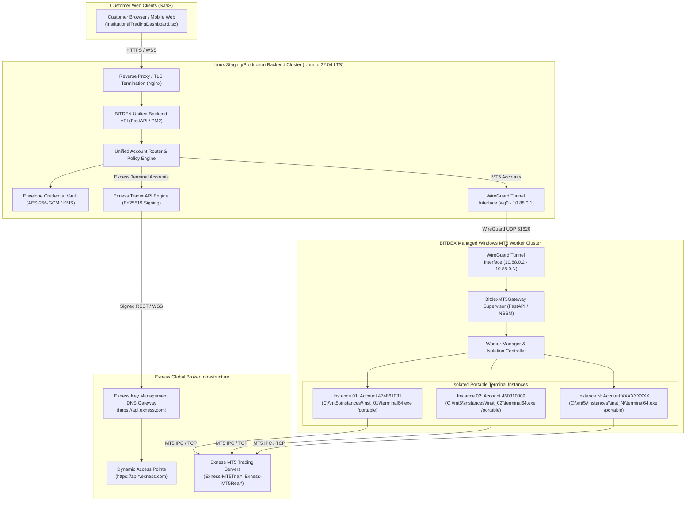
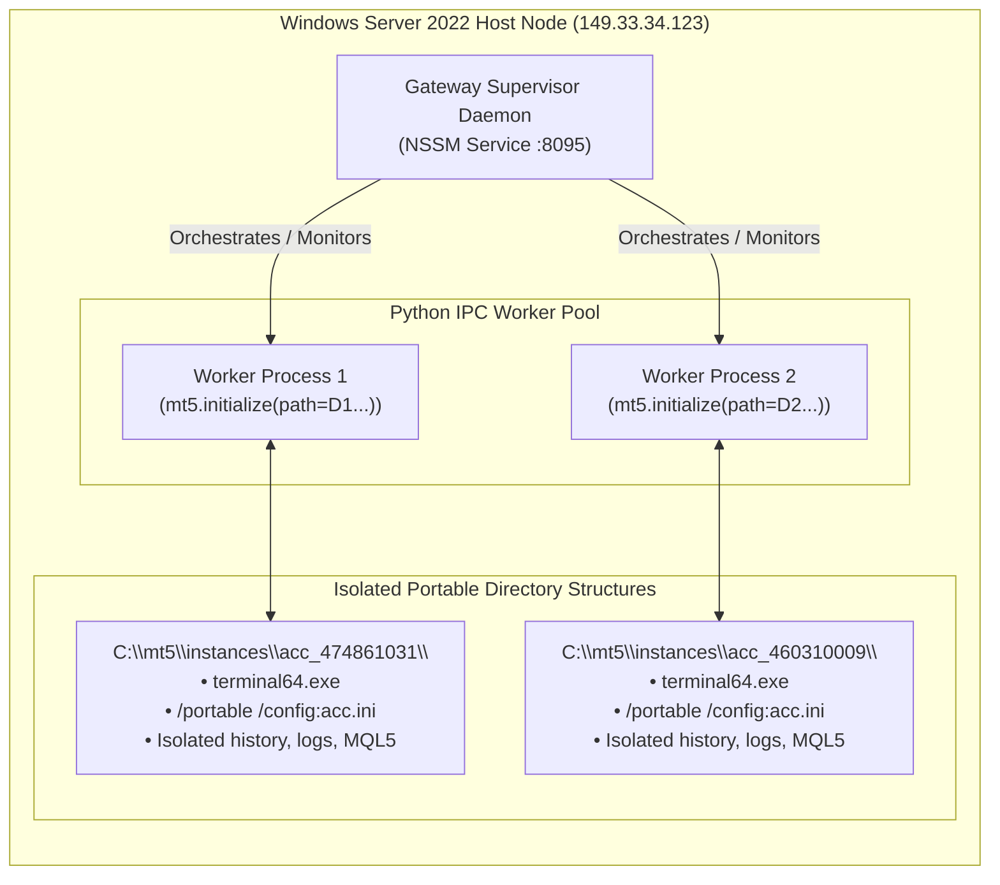

# BITDEX — Phase 7B: Commercial Multi-Tenant Architecture Blueprint
## Institutional Cloud-Hosted Exness Trading API & Multi-Tenant Windows MT5 Worker Architecture

**Author**: Antigravity (Deepmind AAC & Quantitative Trading Systems)  
**Date**: 2026-11-07  
**Platform**: `https://bitdex.ltd`  
**Repository**: `https://github.com/nexuratechpteltd-tech/bitdex-platform`  
**Target Branch**: `feature/hft-redesign-and-navigation-cleanup`  
**Status**: DESIGN COMPLETE — AWAITING EXPLICIT USER REVIEW & APPROVAL BEFORE PHASE 7C IMPLEMENTATION

---

## Executive Summary & Design Mandate

The primary commercial objective of BITDEX is to deliver institutional-grade algorithmic trading (Sub-second HFT, Grid, and Long-Term Quantitative Strategies) to retail and institutional subscribers without requiring customers to operate their own VPS, RDP, or MT5 installation. BITDEX owns, manages, scales, and operates the entire underlying execution infrastructure.

### Dual-Engine Commercial Support
1. **Exness-Platform Accounts**: Communicates directly from Linux Backend cluster via official **Exness Trading REST & WebSocket API** using cryptographic Ed25519 request signing. Covers accounts using Exness native engine (`dx.2.real.std`, Exness Terminal/Trade App).
2. **MetaTrader 5 (MT5) Accounts**: Communicates via BITDEX-managed **Windows MT5 Multi-Tenant Worker Pools** over private encrypted WireGuard VPN tunnels. Covers Exness MT5 Standard, Raw Spread, Pro, and Zero accounts across both DEMO and REAL environments.



---

## 1. Unified Account Model (Database Architecture)

Currently, account data is split across `user_exchange_connections` and `exness_demo_connections`. For Phase 7C, we introduce a unified, multi-tenant relational schema: `trading_accounts`.

### 1.1 Relational Schema (`trading_accounts`)

```sql
CREATE TABLE trading_accounts (
    account_id TEXT PRIMARY KEY,                 -- Internal UUID: ACC-A4E7BE39D276
    user_id TEXT NOT NULL,                        -- Tenant ID: USR-ADM-B022F490
    broker_name TEXT NOT NULL DEFAULT 'EXNESS',  -- EXNESS, BINANCE, BYBIT
    platform TEXT NOT NULL,                       -- EXNESS_TERMINAL, MT5, MT4, BINANCE_PERP
    environment TEXT NOT NULL,                    -- DEMO, REAL, PAPER
    broker_login TEXT NOT NULL,                   -- Broker Login ID: 474861031, 16000629657
    server_name TEXT NOT NULL,                    -- Exness-MT5Trial15, https://api.exness.com
    account_tier TEXT DEFAULT 'STANDARD',         -- Standard, RawSpread, Pro, Zero
    currency TEXT NOT NULL DEFAULT 'USD',
    leverage INTEGER NOT NULL DEFAULT 2000,
    
    -- Connection & Verification Lifecycle
    connection_status TEXT NOT NULL DEFAULT 'DISCONNECTED', 
    -- CONNECTED, DISCONNECTED, AUTH_FAILED, RECONNECTING, SUSPENDED
    verification_status TEXT NOT NULL DEFAULT 'UNVERIFIED', 
    -- UNVERIFIED, ACCOUNT_DATA_VERIFIED, REJECTED
    is_active INTEGER NOT NULL DEFAULT 1,
    is_preferred INTEGER NOT NULL DEFAULT 0,
    
    -- Telemetry Cache (Updated via delta streams / worker heartbeats)
    balance_usd REAL DEFAULT 0.0,
    equity_usd REAL DEFAULT 0.0,
    margin_used REAL DEFAULT 0.0,
    margin_free REAL DEFAULT 0.0,
    floating_pnl REAL DEFAULT 0.0,
    
    -- Worker Assignment (For MT5 Gateway Instances)
    worker_node_id TEXT,                          -- e.g. WIN-NODE-01
    worker_instance_id TEXT,                      -- e.g. INST-474861031
    worker_port INTEGER,                          -- e.g. 8095
    
    -- Cryptographic Credential Vault Reference
    vault_credential_ref TEXT NOT NULL,           -- VLT-SEC-XXXXX (Envelope Key Ref)
    real_consent_id TEXT,                         -- CNS-57D834752F5F (if REAL)
    
    -- Audit & Timestamps
    last_connected_at TEXT,
    last_synced_at TEXT,
    created_at TEXT NOT NULL,
    updated_at TEXT NOT NULL,
    
    FOREIGN KEY (user_id) REFERENCES users(user_id) ON DELETE CASCADE,
    FOREIGN KEY (real_consent_id) REFERENCES real_trading_consents(consent_id)
);

CREATE INDEX idx_trading_accounts_user ON trading_accounts(user_id, is_active);
CREATE INDEX idx_trading_accounts_worker ON trading_accounts(worker_node_id, worker_instance_id);
CREATE UNIQUE INDEX idx_trading_accounts_tenant_login ON trading_accounts(user_id, broker_login, server_name);
```

---

## 2. Exness Trading API Engine

### 2.1 Engine Capabilities & Scope
The Exness Trading API engine interacts with accounts created on the Exness proprietary platform (`dx.*` stream IDs). It does not interface with MT5 accounts.

- **DNS Dynamic Discovery**: Calls `/v1/trading/access-point?account_id={id}` on `https://api.exness.com` to discover the target cluster endpoint (e.g. `https://ap-2c49ed65.exness.com`).
- **Ed25519 Cryptographic Request Signing**:
  Every REST request and WebSocket handshake signs:
  $$\text{Payload} = \text{HTTP\_METHOD} + \text{PATH} + \text{IDEMPOTENCY\_KEY} + \text{TIMESTAMP} + \text{BODY}$$
  Signed with the customer's private Ed25519 key using the `EXN-API-KEY` header authentication scheme.
- **WebSocket Streaming Engine**:
  Maintains persistent bi-directional connection to `wss://ap-2c49ed65.exness.com/ws`:
  - `account_state` topic: realtime equity, margin, and balance updates.
  - `orders` topic: order execution and fill events.
  - `positions` topic: real-time position updates and trailing stops.

---

## 3. MT5 Multi-Tenant Worker-Pool Architecture

### 3.1 Problem Statement & Terminal Constraints
1. **Single MT5 GUI Process Limitation**: A running `terminal64.exe` instance can only be logged into one broker account at a time. If user A logs in, user B is disconnected.
2. **Session 0 Service Isolation**: Windows Services running under `LocalSystem` operate in non-interactive Session 0. MetaTrader 5 requires an initial desktop heap to initialize graphical UI components before Python IPC functions can hook into it.

### 3.2 The Isolated Portable Instance Solution
To achieve true multi-tenancy on Windows Server without customer-managed machines, BITDEX deploys an **Automated Instance Orchestrator**:



1. **Portable Directory Template**:
   - Master binary template stored in `C:\mt5\template\`.
   - On account provision, a symlink/hardlink clone is provisioned at `C:\mt5\instances\{account_id}\`.
   - Launched using: `terminal64.exe /portable /config:startup.ini`.
2. **Python Worker Subprocesses**:
   - The Gateway server spawns dedicated worker subprocesses for each active account.
   - Each worker calls `mt5.initialize(path=r"C:\mt5\instances\{account_id}\terminal64.exe")`.
   - Inter-Process Communication (IPC) is maintained over local Unix domain sockets or loopback ports (`127.0.0.1:8100..8200`), managed by the Gateway Supervisor.
3. **Session 0 GUI Emulation**:
   - NSSM launches an auto-logged-in background desktop session (`bitdex_runner` user), ensuring the Windows desktop heap is active and GPU hardware acceleration is bypassed via `/portable` headless configuration flags.

---

## 4. Security & Commercial Readiness

### 4.1 Envelope Key Credential Vault
- **Master Key**: Hardware Security Module (HSM) or cloud KMS (AES-256-GCM).
- **Tenant Data Key (DEK)**: Unique per customer, encrypted by the Master Key (KEK).
- Credentials stored with cryptographic binding to `user_id` in Associated Data (AAD).
- Zero plaintext passwords in memory; credentials decrypted only within isolated worker scope during initial handshake.

### 4.2 Legal, Broker & Regulatory Compliance
1. **MetaQuotes Licensing Terms**: MetaTrader 5 client terminal is licensed for individual account operation. For commercial multi-tenant SaaS hosting, BITDEX must ensure:
   - Terminals are operated on dedicated customer behalf as an authorized agent.
   - For scale > 1,000 accounts, BITDEX will evaluate a formal **MetaTrader 5 White Label / Server API Gateway** license.
2. **Exness API Terms of Service**:
   - Compliance with Exness API rate limits (10 requests/sec per API key).
   - Real-account trading strictly bound to explicit customer consent (`REAL-CONSENT-v2`) with recorded step-up authentication.

---

## 5. Capacity & Infrastructure Cost Modeling

### 5.1 Measured Benchmark Telemetry (from Windows VPS `149.33.34.123`)
- **Idle `terminal64.exe` (1 open symbol chart)**:
  - Working Set RAM: **`166.01 MB`**
  - Private Memory: **`75.75 MB`**
  - CPU Usage: **`< 0.5%`**
- **Python IPC Worker Process**:
  - Working Set RAM: **`56.41 MB`**
  - Private Memory: **`45.98 MB`**
- **Total Footprint Per Account**: ~**`220 MB RAM`** | **`~0.05 vCPU`** (at 10s tick throttle).

### 5.2 Multi-Tier Capacity & Scaling Projections

| Subscriber Scale | Active MT5 Accounts | Required RAM | Required vCPU | Recommended Infrastructure Topology | Estimated Monthly Cost |
| :--- | :--- | :--- | :--- | :--- | :--- |
| **10 Customers** | 10 | 3.5 GB | 2 vCPUs | 1x Dedicated Windows Cloud VPS (8GB RAM, 4 vCPUs) | **$45 / mo** |
| **50 Customers** | 50 | 14 GB | 4 vCPUs | 1x High-Memory Windows Cloud VPS (16GB RAM, 8 vCPUs) | **$120 / mo** |
| **100 Customers** | 100 | 28 GB | 8 vCPUs | 1x Dedicated Bare-Metal Server (32GB RAM, 8 Cores) | **$190 / mo** |
| **500 Customers** | 500 | 140 GB | 32 vCPUs | 2x Dedicated Bare-Metal Hosts (64GB RAM each) + Redis Cluster | **$550 / mo** |
| **1,000 Customers**| 1,000 | 280 GB | 64 vCPUs | 4x Dedicated Bare-Metal Host Cluster + Load Balanced Gateways | **$1,100 / mo** |

*Note: Estimates assume 1 account per customer, charts configured to min bars (5,000 max history bars in chart), and background tick throttling enabled.*

---

## 6. Implementation Sequence (Phase 7C Roadmap)

Upon user approval of this blueprint, Phase 7C will proceed in the following structured sequence:

1. **Stage 1 — Unified Database Migration**: Apply `trading_accounts` schema, migrating existing Exness demo/real rows without downtime.
2. **Stage 2 — Tenant-Level Credential Vault Envelope**: Implement DEK envelope encryption with customer isolation.
3. **Stage 3 — Exness Trader API Realtime Streamer**: Deploy persistent WebSocket connection manager for `dx.*` accounts.
4. **Stage 4 — Windows MT5 Instance Manager**: Implement `C:\mt5\instances\` portable cloner and NSSM process manager.
5. **Stage 5 — Unified Account Router**: Route `/api/v1/saas/customer/trading/*` through the unified adapter abstraction.
6. **Stage 6 — Customer Dashboard Integration**: Enable self-service account connection, auto-provisioning, and isolated multi-tenant portfolio views.
7. **Stage 7 — Commercial Load Testing**: Execute synthetic concurrency benchmarks on 10 isolated demo accounts.
