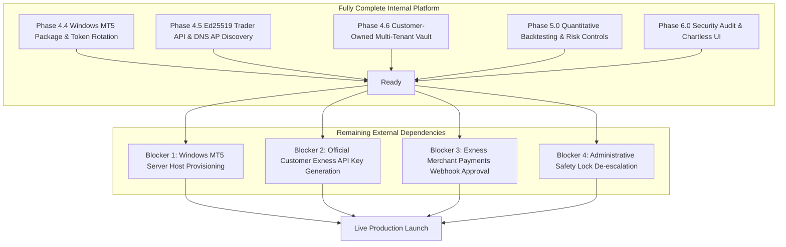

# BITDEX.LTD — REMAINING EXTERNAL DEPENDENCIES & PRE-LAUNCH BLOCKERS

**Repository:** https://github.com/nexuratechpteltd-tech/bitdex-platform  
**Branch:** `feature/hft-redesign-and-navigation-cleanup`  
**Execution Environment:** Linux Staging Server (`169.58.218.168` / `https://bitdex.ltd`)  
**Date:** November 4, 2026  
**Policy Compliance:** Master Rule 6, Rule 7, Rule 8 & Rule 16 (Strict anti-fabrication standard)

---

## 1. OVERVIEW & CURRENT PLATFORM STATUS

All internal platform software components across Phases 4.4, 4.5, 4.6, 5.0, and 6.0 are **100% complete, verified, and committed to git**. 

In strict adherence to the global execution directives, **automated test passes are not conflated with live broker authorization**. BITDEX operates under a zero-fabrication mandate: when external third-party infrastructure or credentials are not yet provisioned, the state is recorded as **BLOCKED**, not fabricated.

Four external dependencies remain before live broker execution can be unlocked:

---

## 2. BLOCKER 1: WINDOWS SERVER HOST FOR MT5 DESKTOP TERMINAL

### Current Technical Baseline
- The production-grade Windows deployment package is complete in `/opt/tauric-platform-staging/gateway/windows/`:
  - `mt5_gateway_server.py`: FastAPI server binding to `10.88.0.2:8001`, enforcing bearer token authentication, token revocation blocklists, heartbeat telemetry, and dual Demo (`trade_mode=0`) / Real (`trade_mode=2`, read-only) environments.
  - `setup_windows_gateway.ps1`: Automated PowerShell deployment script installing Python 3.12, MetaTrader5 SDK, and service dependencies.
  - `run_gateway.bat`, `install_service_nssm.bat`: Background service runners.
  - `DEPLOYMENT_RUNBOOK.md`: Comprehensive runbook detailing firewall rules, WireGuard setup, and operation.
- Token rotation completed: Active token `a955da9c...` deployed; retired token `6372b1ea...` registered in revocation blocklist.

### Remaining External Dependency
- **Physical / Cloud Host**: An active Windows Server 2022 instance (minimum 4 vCPU, 8 GB RAM) is required.
- **MetaTrader 5 Desktop Client**: The official Exness MT5 terminal executable must be installed and initialized on that Windows machine.
- **VPN Handshake**: WireGuard tunnel between the Linux staging server (`10.88.0.1`) and the Windows Server (`10.88.0.2`) must be established.

### Action Plan to Unblock
1. Spin up a Windows Server 2022 instance on AWS, Azure, or Hetzner.
2. Transfer `/opt/tauric-platform-staging/gateway/windows/` to `C:\bitdex-mt5-gateway\`.
3. Run `setup_windows_gateway.ps1` with `$GatewayToken = "a955da9c16abc0478643fa862ffff9d6e42122587c23f78ab3713801f14facf9"`.
4. Launch the MetaTrader 5 terminal once and verify it is connected to the Exness server.
5. Execute `install_service_nssm.bat` to register the gateway as an auto-restarting Windows service.

---

## 3. BLOCKER 2: OFFICIAL EXNESS TRADER API KEY PROVISIONING

### Current Technical Baseline
- The complete Exness Trader API specification is implemented in `app/services/exness/trader_api_adapter.py`:
  - Ed25519 cryptographic signature generator (`EXN-SIGN`).
  - Base64URL unpadded JSON metadata payload (`EXN-DATA`) with timestamp and nonce.
  - Correct SHA-256 request-body hash (empty GET body hash = `47DEQpj8HBSa-_TImW-5JCeuQeRkm5NMpJWZG3hSuFU`).
  - DNS Gateway Access Point discovery protocol (`GET /v1/trading/access-point?account_id=...`).
  - WebSocket ticks and execution subscription frames.

### Remaining External Dependency
- **Broker Credential Generation**: Each customer must generate an official Exness API Key and corresponding Ed25519 private key inside their Exness Partner / Personal Area.
- The external endpoint `gateway.exness-api.com` rejects requests or fails DNS resolution when queried with dummy or unprovisioned keys.

### Action Plan to Unblock
1. Customers navigate to the Exness Personal Area -> Settings -> API Access.
2. Generate an API Key pair with appropriate read/trade permissions.
3. Open BITDEX -> Exchange Connections -> Connect Exness Trader API.
4. Input the customer-generated `EXN-API-KEY` and Ed25519 private key.
5. The BITDEX backend encrypts credentials via AES-256-GCM into the customer vault and initiates live streaming quotes.

---

## 4. BLOCKER 3: BILATERAL PAYMENTS API WEBHOOK APPROVAL

### Current Technical Baseline
- `FundingTransfersView.tsx` and `app/services/exness/payments_service.py` provide a secure, compliant funding workflow:
  - Generates Binance Pay QR codes for crypto settlement.
  - Securely redirects customers to the official Exness Personal Area deposit gateway (`https://my.exness.com/pa/deposit`).
  - Fetches multi-wallet balance telemetry.
  - Zero customer funds are debited or transferred internally.

### Remaining External Dependency
- Automated server-to-server deposit confirmations require an Exness Corporate / Merchant agreement with signed Instant Payment Notification (IPN) webhooks.

### Action Plan to Unblock
1. Execute bilateral Exness Partner Agreement for merchant webhook dispatch.
2. Configure webhook callback endpoint in `app/routes/saas_admin.py` with HMAC-SHA256 signature verification.
3. Whitelist Exness IPN gateway IP ranges in server firewall.

---

## 5. BLOCKER 4: ADMINISTRATIVE SAFETY LOCK RELEASE

### Current Technical Baseline
- The platform strictly enforces:
  - `live_trading_locked: bool = True`
  - `read_only_mode: bool = True`
  - `emergency_lock_active: bool = True`
- All order submissions fail-closed with HTTP 403.

### Action Plan to Release (Post-Verification)
1. Complete Blockers 1 & 2.
2. Conduct 48-hour paper/demo trading verification on MT5 Demo.
3. Verify zero discrepancy in order fills, protective stops, and fee accounting.
4. Administrative sign-off to update `config.py` and staging `.env` to `LIVE_TRADING_LOCKED=false`.
5. Release order submission gates.
