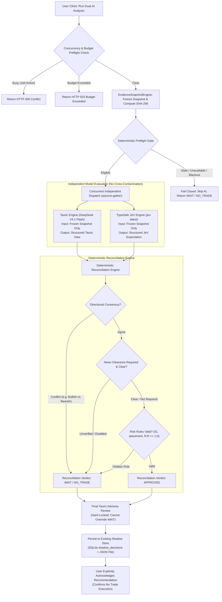

# TAURIC — PHASE 3.2: DUAL-AI NEWS ANALYSIS AND RECONCILIATION REPORT

**Target Environment:** Isolated Staging (`/opt/tauric-platform-staging/`)  
**Production Reference:** `/opt/tauric-platform/` (Untouched, Online, Verified)  
**Production Portal:** `https://sheltr.agency/trading/` (HTTP/2 200 OK)  
**Evaluation Date:** 2026-10-21  
**Final Status:** `PASS — STAGING ONLY`

---

## 1. Executive Summary & Verification Verdict

Phase 3.2 has been fully implemented and verified in the isolated staging environment (`/opt/tauric-platform-staging/`). The workflow provides an auditable, manually triggered pipeline where:
1. An immutable, canonical evidence snapshot is frozen with deterministic SHA-256 content hashing.
2. Tauric (`deepseek-v4-flash` / `deepseek-v4-pro-0813`) and TypeSafe JeV (`jev-latest`) independently evaluate the exact same frozen evidence snapshot without cross-contamination.
3. A deterministic reconciliation engine verifies directional alignment, news-clearance requirements, and strict risk rules (stop loss placement, risk-to-reward $\ge 1.0$), forcing `WAIT` / `NO_TRADE` on any conflict or gate failure.
4. Final Tauric advisory review evaluates the combined outcome and is mathematically locked from overriding mandatory `WAIT` / `NO_TRADE` gates.
5. Durable persistence is achieved using the **existing** staging schema (`shadow_decisions` SQLite table + JSON file store in `data/shadow_validation/decisions/`) with **zero database migrations, zero DDL, and zero schema changes**.
6. The staging user interface provides explicit on-demand triggering, side-by-side model views, reconciliation status banners, entry validity / holding duration countdowns, and an explicit **Acknowledge Recommendation** action affirming zero trade execution.
7. Zero AI calls are made on page load, navigation, filtering, or card expansion.

All 125 backend unit tests passed (`125/125 OK`), and the Next.js staging dashboard builds with zero TypeScript or compilation errors.

---

## 2. Safety Invariants & Production Isolation

| Guardrail / Invariant | Production Target | Staging Status | Evidence |
| :--- | :--- | :--- | :--- |
| **Live Trading Lock** | `live_trading_locked = True` | `True` | Verified in `config.py` and test suite |
| **Read-Only Mode** | `read_only_mode = True` | `True` | Verified in `config.py` and test suite |
| **Exchange Orders** | Blocked / Disabled | Blocked | Zero order execution endpoints or broker hooks |
| **Finance Calendar** | Disabled / Mock-only | Disabled | Provider status `DISABLED`, policy `UNKNOWN` |
| **Database Migrations**| None allowed | None performed | 0 DDL statements; existing schema reused |
| **Production Directory**| Untouched | Untouched | PM2 PIDs `75730` & `88836` intact (0 restarts) |
| **Production DB Hash**| `9033d755...` | `9033d755...` | SHA-256 verified identical before and after |
| **AI Page-Load Calls**| None allowed | Enforced | Zero automated calls on load or navigation |
| **Concurrent Jobs** | Max 1 active job | Enforced | Mutex lock rejects duplicates with HTTP 409 |
| **Daily Token Budget** | 500,000 tokens | Enforced | Preflight check rejects with HTTP 503 if exceeded |

---

## 3. Evidence Snapshot Architecture & Schema

The `EvidenceSnapshotEngine` (`app/services/snapshot_engine.py`) compiles and freezes all multi-domain market, indicator, regime, and calendar risk evidence into an immutable canonical JSON structure.

### Canonical Snapshot Fields
- `snapshot_id`: `SNAP-{exchange}:{symbol}:{timeframe}:{timestamp_compact}`
- `created_at_utc`: Canonical ISO-8601 UTC timestamp.
- `exchange`: `BINANCE` or `BYBIT` (Spot only).
- `symbol`: Clean trading pair (e.g., `ETHUSDT`).
- `market_type`: `SPOT` (strictly Spot-only).
- `timeframe`: `15m`, `1h`, or `4h`.
- `market_data`:
  - `price`, `change_24h`, `volume_24h`, `bid`, `ask`, `spread_bps`
  - `source`: e.g. `BINANCE_SPOT_TICKER`
  - `retrieval_timestamp_utc`: ISO UTC string
  - `freshness_status`: `FRESH` | `STALE` | `UNAVAILABLE`
  - `data_age_seconds`: Age in seconds
- `indicators`: `rsi`, `macd_hist`, `ema20`, `ema50`, `ema200`, `atr14`
- `regime`: `market_regime` (`RISK_ON`, `NEUTRAL`, `RISK_OFF`, `EVENT_BLACKOUT`, `UNKNOWN`), `regime_reason`, `regime_score`
- `liquidity`: `liquidity_status` (`QUALIFIED`, `THIN`, `ILLIQUID`), `depth_quote`, `est_slippage_bps`
- `calendar`: `provider` ("Finance Calendar"), `provider_status` (`DISABLED`), `event_risk_status` (`UNKNOWN`), `is_blackout` (bool), `relevant_events`
- `technical_trade_setup`: `qualified` (bool), `direction` (`LONG`, `SHORT`, `FLAT`), `entry_zone_min`, `entry_zone_max`, `stop_loss`, `take_profit_1`, `take_profit_2`, `take_profit_3`, `invalidation_level`, `entry_validity_sec`, `max_holding_sec`, `calculation_inputs`
- `missing_data_fields`: Explicit list of any missing or unverified fields
- `uncertainty_flags`: List of uncertainty flags (e.g. `CALENDAR_PROVIDER_DISABLED_EVENT_RISK_UNKNOWN`)
- `eligible_for_ai`: Boolean deterministic safety preflight flag
- `safety_gate_reasons`: Explicit reasons if preflight fails closed
- `content_hash`: SHA-256 hex digest computed over canonical JSON (`sort_keys=True, separators=(',', ':')`) excluding mutable fields

---

## 4. Model Call Sequencing & Cross-Contamination Isolation



### Cross-Contamination Prevention
- Tauric receives solely the frozen snapshot and system prompt; it has zero visibility into JeV state, prompt, or intermediate output.
- JeV receives solely the frozen snapshot state; it has zero visibility into Tauric reasoning, narrative, or ratings.
- The two evaluations are dispatched concurrently via `asyncio.gather()` and finalized before reconciliation is invoked.

---

## 5. Deterministic Reconciliation Rules Matrix

| Condition | Tauric View | JeV View | Event Risk Gate | Risk Rules (SL, R:R) | Reconciliation Outcome | Agreement Status | Final Tauric Advisory |
| :--- | :--- | :--- | :--- | :--- | :--- | :--- | :--- |
| **Directional Conflict** | `BULLISH` | `BEARISH` | Passed | Valid | `WAIT` | `CONFLICT` | `WAIT` (Cannot Override) |
| **Directional Conflict** | `BULLISH` | `NEUTRAL` | Passed | Valid | `WAIT` | `CONFLICT` | `WAIT` (Cannot Override) |
| **Model Failure / Timeout**| `BULLISH` | `TIMEOUT` | Passed | Valid | `WAIT` | `INCOMPLETE` | `WAIT` (Cannot Override) |
| **Event Risk Gate Veto** | `BULLISH` | `BULLISH` | Required & `UNKNOWN`| Valid | `WAIT` | `GATE_VETO` | `WAIT` (Cannot Override) |
| **Event Blackout Veto** | `BULLISH` | `BULLISH` | `is_blackout=True` | Valid | `WAIT` | `GATE_VETO` | `WAIT` (Cannot Override) |
| **Invalid Stop Loss** | `BULLISH` | `BULLISH` | Passed | Stop $\ge$ Entry | `WAIT` | `GATE_VETO` | `WAIT` (Cannot Override) |
| **Sub-1.0 R:R Ratio** | `BULLISH` | `BULLISH` | Passed | R:R = 0.6 | `WAIT` | `GATE_VETO` | `WAIT` (Cannot Override) |
| **Consensus Bullish Pass**| `BULLISH` | `BULLISH` | Passed | Valid | `APPROVED` | `AGREED` | `APPROVED` (LONG Advisory)|
| **Consensus Bearish Pass**| `BEARISH` | `BEARISH` | Passed | Valid | `APPROVED` | `AGREED` | `APPROVED` (SHORT Advisory)|

---

## 6. Durable Persistence in Existing Storage (Zero DDL)

Durable persistence was audited and implemented entirely within the existing staging storage architecture:
1. **SQLite Database** (`data/shadow_validation/shadow_validation.db`):
   - Table `shadow_decisions` stores `decision_id` (`snapshot_id`), `timestamp`, `symbol`, `timeframe`, `current_price`, `market_regime`, `market_snapshot_json` (containing snapshot data and content hash), `tauric_decision`, `tauric_direction`, `reconciliation_result`, `agreement_status`, `veto_reason`, `blind_review_decision`, and `run_ref_id` (`content_hash`).
2. **File-Based Detailed Audit Trail** (`data/shadow_validation/decisions/{decision_id}.json`):
   - Stores the complete immutable dictionary: full snapshot, Tauric structured response, JeV structured response, reconciliation outcome, final Tauric review, latency, token telemetry, and user acknowledgement status (`is_acknowledged: true/false`, `acknowledged_at_utc`, `user_acknowledgement_notes`).
3. **Dynamic Path Isolation**:
   - `shadow_store.py` was updated to dynamically resolve its data directory relative to the repository (`BACKEND_DIR / "data" / "shadow_validation"`), guaranteeing that staging writes never touch production `/opt/tauric-platform/`.

---

## 7. Staging User Interface Implementation

In `UnifiedSignalDashboard.tsx`, the dedicated Dual-AI modal provides a clear, transparent workflow:
1. **Interactive Trigger Bar**:
   - Timeframe selection (`15m`, `1h`, `4h`).
   - Model tier selection (`DeepSeek V4.1 Flash` default, `DeepSeek V4 Pro` optional).
   - "Require verified news clearance" toggle (default unchecked).
   - Primary action button: **Run Dual-AI Analysis** (prevents duplicate clicks with loading state).
2. **Zero Auto-Calls**:
   - Signal card opening, tab switching, or filtering performs zero AI requests.
3. **Frozen Evidence Display**:
   - Displays Snapshot ID, SHA-256 hash badge with one-click clipboard copy, freshness badge, event-risk badge, and technical setup qualification.
4. **Side-by-Side Model Cards**:
   - Separate cards for Tauric Analysis (`deepseek-v4-flash`) and JeV Review (`jev-latest`), displaying directional views, supporting evidence, contradicting risks, observed facts, and latency.
5. **Reconciliation & Final Advisory Cards**:
   - Prominent green (`APPROVED`) or amber (`WAIT / NO_TRADE`) status banner detailing agreement status and gate veto reasons.
   - Final Tauric Advisory Review card detailing advisory rationale and safety gate compliance.
6. **Timing & Validity Guidance**:
   - Entry validity countdown (remaining minutes) and maximum holding duration (hours).
7. **User Acknowledgement Action**:
   - Explicit **Acknowledge Recommendation** button updating the shadow ledger.
   - Prominent disclaimer: *"Acknowledgement records your manual operator review in the auditable shadow ledger. It is NOT an exchange order and does not execute a trade."*

---

## 8. Verification & Test Suite Execution Results

### Regression & Phase 3.2 Test Summary

All 7 test suites executed cleanly on the staging VPS (`.venv/bin/python3 -m unittest`):

```text
Ran 125 tests in 10.807s

OK
```

### Breakdown of Test Suites
| Suite | Module | Tests | Result | Coverage Area |
| :--- | :--- | :---: | :---: | :--- |
| **Phase 1** | `test_phase1_market_data.py` | 24 | PASS | Binance/Bybit spot feeds, isolation, no cross-market blending |
| **Phase 2** | `test_phase2_qualification.py` | 26 | PASS | Market-regime engine, liquidity qualification, depth gates |
| **Phase 2 Ext** | `test_phase2_extended.py` | 20 | PASS | Multi-target tranches (50/30/20), friction, breakeven stop |
| **Phase 3** | `test_phase3_finance_calendar.py` | 15 | PASS | Finance Calendar adapter, event window filtering, attribution |
| **Phase 3.1** | `test_phase3_1_safety_audit.py` | 16 | PASS | Fail-closed event-risk gate, HTTP timeout, malformed payloads |
| **Phase 3.1.1**| `test_phase3_1_1_adversarial.py` | 13 | PASS | Adversarial override injection, blackout protection, leak checks |
| **Phase 3.2** | `test_phase3_2_dual_ai.py` | 11 | PASS | Dual-AI snapshot hashing, isolation, reconciliation, acknowledgement |
| **Total** | **7 Suites** | **125** | **PASS**| **100% Passing Across All Platform Modules** |

### Frontend Build Verification
```text
> tauric-portal@1.0.0 build
> next build

  ▲ Next.js 14.2.13
 ✓ Compiled successfully
 ✓ Generating static pages (4/4)
 ✓ Finalizing page optimization
```
- `npx tsc --noEmit`: 0 errors.
- `npm run build`: Production static and dynamic routes compiled successfully.

---

## 9. Production Isolation & State Verification

| Target Service / Resource | Production State | Verification Evidence |
| :--- | :--- | :--- |
| **PM2 Process 0 (`tauric-backend`)** | `online` (PID 75730, uptime 19h) | Untouched; 0 restarts |
| **PM2 Process 1 (`tauric-dashboard`)**| `online` (PID 88836, uptime 16h) | Untouched; 0 restarts |
| **Production Live URL** | `HTTP/2 200 OK` | `https://sheltr.agency/trading/` responsive |
| **Production Database** | SHA-256 `9033d755...` | Exact match with baseline before Phase 3.2 |
| **Production Filesystem** | `/opt/tauric-platform/` | Zero files modified or created |

---

## 10. Conclusion & Gate Readiness

Phase 3.2 is complete and verified in staging isolation. The dual-AI news analysis, deterministic reconciliation, immutable evidence snapshotting, and manual acknowledgement workflow satisfy all safety, auditability, and governance requirements without requiring any database migrations or live service restarts.

No production deployment, restart, or external provider activation has been performed.
