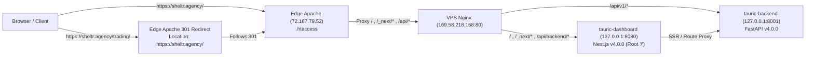

# TAURIC — Canonical Domain Consolidation & Production Migration Report (`https://sheltr.agency/`)

**Date (UTC):** `2026-10-24T00:30:00Z`  
**Canonical Entry Point:** `https://sheltr.agency/`  
**Legacy Route Redirect:** `https://sheltr.agency/trading/` $\rightarrow$ `HTTP 301` $\rightarrow$ `https://sheltr.agency/`  
**Production Release:** `v4.0.0` (`/opt/tauric-platform/` $\rightarrow$ `/opt/tauric-platform-releases/v4.0.0/`)  
**Safety Invariants:** `live_trading_locked=true` | `read_only_mode=true` | `POST /api/v1/orders/live/submit` $\rightarrow$ `HTTP 403`

---

## 1. Pre-Migration Domain and Routing Audit

Before touching any production or edge files, we audited both servers in the request path for `https://sheltr.agency/`:

### 1.1 Edge Reverse Proxy (`72.167.79.52` — GoDaddy cPanel Apache Host)
- **Public DNS (`sheltr.agency`):** Resolves to `72.167.79.52` (Apache with `mod_rewrite` + `mod_proxy`).
- **Document Root:** `/home/zetzgm5y7jjq/sheltr.agency/`.
- **Pre-Migration Root Routing (`/home/zetzgm5y7jjq/sheltr.agency/.htaccess`):**
  - Previously matched `REQUEST_URI ^/$` and issued a `302` redirect to `https://sheltr.agency/login`.
  - Proxied all non-`/trading` requests to `http://127.0.0.1:33700/$1` (a local Next.js app: `Sheltr CRM — Private Lead Management Portal`).
- **Pre-Migration `/trading/` Routing (`/home/zetzgm5y7jjq/sheltr.agency/trading/.htaccess`):**
  - Proxied `/trading/*` to `http://169.58.218.168%{REQUEST_URI}` (`[P,L]`).

### 1.2 TAURIC Application Server (`169.58.218.168` — Germany VPS)
- **Nginx (`/etc/nginx/sites-available/tauric-portal.conf`):**
  - Listened on ports `80` and `443` (`server_name sheltr.agency www.sheltr.agency 169.58.218.168 ...`).
  - Proxied `/api/v1/` to `http://127.0.0.1:8001/api/v1/` (`tauric-backend`, PM2 id `0`).
  - Proxied `/trading` and `/` to `http://127.0.0.1:8080` (`tauric-dashboard`, PM2 id `1`).
- **Production vs. Staging State Pre-Migration:**
  - **Production (`/opt/tauric-platform/`):** Was running release `v3.9.0` with `basePath: '/trading'` in `next.config.mjs`. This is why navigating to `https://sheltr.agency/trading/` still rendered the older `v3.9.0` UI prior to this migration.
  - **Staging (`/opt/tauric-platform-staging/`):** Contained the verified Universal API Connection Manager rebuild, 4-field credential-first Add API form, post-save Provider Identification, **Permissions & Capabilities** modal, and universal strategy orchestration.
- **Production Vault Audit (`/opt/tauric-platform/backend/data/credential_vault.json`):**
  - Contained **1 real user-saved profile**: `prof_bitget_demo_a2bb3478` (label: `Master`, exchange: `BITGET`, product: `FUTURES_USDT`, environment: `DEMO`, updated `2026-10-23T23:36:09Z`).
  - Unlike the earlier staging test profile (`prof_bitget_demo_0b9f1ff0`), the production `Master` profile (`prof_bitget_demo_a2bb3478`) **does** have the user's encrypted 8-character Bitget passphrase (`api_key` len 35, `api_secret` len 64, `passphrase` len 8).

---

## 2. Backup Manifest and Rollback Instructions

### 2.1 Complete Backup Manifest
All production code, builds, configurations, Nginx definitions, PM2 process snapshots, data stores, credential vaults, and edge `.htaccess` configurations were backed up prior to cutover:

| Server | Backup Location | Backed-Up Components |
| :--- | :--- | :--- |
| **Application Server (`169.58.218.168`)** | `/opt/tauric-platform/backups/canonical_cutover_20261024T001200Z/` | `backend_app_prev/` (`v3.9.0/backend/app`), `backend_data/` (including `credential_vault.json`, `active_strategies.json`, `order_lifecycle_store.json`), `backend.env`, `dashboard_src_prev/`, `dashboard_next_prev/`, `next.config.mjs.bak`, `package.json.bak`, `tauric-portal.conf.bak`, `pm2_jlist_pre_cutover.json`, `health_pre_cutover.json` |
| **Release Snapshot (`169.58.218.168`)** | `/opt/tauric-platform-releases/v3.9.0/` | Complete immutable `v3.9.0` backend and frontend release directory preserved untouched |
| **Edge Server (`72.167.79.52`)** | `/home/zetzgm5y7jjq/sheltr.agency/backups_canonical_cutover_20261024/` | `root.htaccess.bak`, `trading.htaccess.bak`, `binance-bot.htaccess.bak`, `_next_july20_bak/`, `trading_dir_bak/` |

### 2.2 Rollback Instructions
If a rollback to the pre-migration `/trading/` topology is ever required:
1. **On `169.58.218.168`:**
   ```bash
   cp /opt/tauric-platform/backups/canonical_cutover_20261024T001200Z/next.config.mjs.bak /opt/tauric-platform/dashboard/next.config.mjs
   ln -sfn /opt/tauric-platform-releases/v3.9.0/backend/app /opt/tauric-platform/backend/app
   rm -rf /opt/tauric-platform/dashboard/src /opt/tauric-platform/dashboard/.next
   cp -a /opt/tauric-platform-releases/v3.9.0/dashboard/src /opt/tauric-platform/dashboard/src
   cp -a /opt/tauric-platform-releases/v3.9.0/dashboard/.next /opt/tauric-platform/dashboard/.next
   cp /opt/tauric-platform/backups/canonical_cutover_20261024T001200Z/tauric-portal.conf.bak /etc/nginx/sites-available/tauric-portal.conf
   nginx -t && systemctl reload nginx
   pm2 restart 0 1
   ```
2. **On `72.167.79.52` (via `/root/run_ssh_cpanel.py`):**
   ```bash
   cp /home/zetzgm5y7jjq/sheltr.agency/backups_canonical_cutover_20261024/root.htaccess.bak /home/zetzgm5y7jjq/sheltr.agency/.htaccess
   mv /home/zetzgm5y7jjq/sheltr.agency/backups_canonical_cutover_20261024/trading_dir_bak /home/zetzgm5y7jjq/sheltr.agency/trading
   cp /home/zetzgm5y7jjq/sheltr.agency/backups_canonical_cutover_20261024/trading.htaccess.bak /home/zetzgm5y7jjq/sheltr.agency/trading/.htaccess
   ```

---

## 3. What Previously Occupied `https://sheltr.agency/` and How It Was Handled

- **Previous Root Occupant:** `https://sheltr.agency/` was previously configured in `/home/zetzgm5y7jjq/sheltr.agency/.htaccess` to `302`-redirect `/` to `/login`, which served `Sheltr CRM — Private Lead Management Portal` running on `127.0.0.1:33700` on `72.167.79.52`.
- **Zero-Loss Coexistence Strategy:**
  - The `Sheltr CRM` process (`127.0.0.1:33700`), its database/files (`/home/zetzgm5y7jjq/sheltr.agency/data/`), and all of its application & API routes (`/login`, `/dashboard`, `/proxy-monitor`, `/proxy-management`, `/browser-stream`, `/api/auth`, `/api/leads`, `/api/proxy`, `/api/generate`, `/api/network`, `/api/duplicate-check`) remain **100% preserved and accessible** via explicit `RewriteCond` rules in `/home/zetzgm5y7jjq/sheltr.agency/.htaccess` (`curl -sI https://sheltr.agency/login` returns `HTTP/2 200`).
  - The root path `https://sheltr.agency/` and all TAURIC routes (`/`, `/_next/*`, `/api/backend/*`, `/api/v1/*`) now route directly to TAURIC production on `169.58.218.168`.

---

## 4. Production Code and Configuration Changes Made

1. **Assembled Production Release `v4.0.0` (`/opt/tauric-platform-releases/v4.0.0/`):**
   - Migrated the verified backend (`exchange_framework.py`, `connections.py`, `orchestration.py`, `strategy_orchestrator.py`, `orders.py`, `main.py`, `config.py`) and frontend (`UnifiedSignalDashboard.tsx`, `page.tsx`, `api/backend/[...slug]/route.ts`) from staging into `/opt/tauric-platform-releases/v4.0.0/`.
2. **Removed `/trading` BasePath Dependency:**
   - Updated `/opt/tauric-platform/dashboard/next.config.mjs` to remove `basePath: '/trading'` so the Next.js application serves natively from `/`.
   - Updated all 34 `/trading/api/backend` fetch endpoints across `dashboard/src/components/UnifiedSignalDashboard.tsx` and `dashboard/src/app/page.tsx` to canonical `/api/backend`.
   - Built a clean production Next.js bundle in `/opt/tauric-platform/dashboard/.next` (`BUILD_ID`: `jyqo4xs5e9qku`).
3. **Cut Over Production Backend & Dashboard (`/opt/tauric-platform/`):**
   - Symlinked `/opt/tauric-platform/backend/app` $\rightarrow$ `/opt/tauric-platform-releases/v4.0.0/backend/app`.
   - Deployed `/opt/tauric-platform-releases/v4.0.0/dashboard/src` and `.next` into `/opt/tauric-platform/dashboard/`.
   - Restarted `tauric-backend` (PM2 id `0`, port `8001`) and `tauric-dashboard` (PM2 id `1`, port `8080`) and saved PM2 state (`pm2 save`).

---

## 5. Canonical Routing Configuration for `https://sheltr.agency/` and `/trading/`



### 5.1 Edge `.htaccess` (`/home/zetzgm5y7jjq/sheltr.agency/.htaccess` on `72.167.79.52`)
- `GET /favicon.ico`, `/favicon.png`, `/logo.png`: Served directly (`HTTP/2 200`).
- `ANY /trading/api/*`: Proxied to `http://169.58.218.168/trading/api/*` so legacy API calls continue working seamlessly.
- `GET /trading` and `GET /trading/*`: Redirected with **`HTTP/2 301`** to `https://sheltr.agency/$1` (single-hop redirect, zero redirect loops).
- `ANY /login`, `/dashboard`, `/proxy-*`, `/browser-stream`, `/api/(auth|leads|proxy|generate|network|duplicate-check)`: Proxied to `http://127.0.0.1:33700/$1` (`Sheltr CRM`).
- `ANY /`, `/_next/*`, `/api/backend/*`, `/api/v1/*`: Proxied to `http://169.58.218.168/$1` (TAURIC Production).

### 5.2 Application Server Nginx (`/etc/nginx/sites-available/tauric-portal.conf` on `169.58.218.168`)
- `/api/v1/` $\rightarrow$ `http://127.0.0.1:8001/api/v1/`
- `/trading/api/backend/` $\rightarrow$ rewritten to `/api/backend/` on `http://127.0.0.1:8080`
- `/trading` and `/trading/` $\rightarrow$ `301 /`
- `/` $\rightarrow$ `http://127.0.0.1:8080`

---

## 6. Data and Credential Preservation Verification

- **Production Credential Vault (`/opt/tauric-platform/backend/data/credential_vault.json`):**
  - Preserved untouched (never overwritten with staging test fixtures).
  - Verified after cutover:
    - Profile ID: `prof_bitget_demo_a2bb3478`
    - Label: `Master`
    - Provider: `BITGET` (`provider_identified: true`)
    - Masked Key: `bg_b••••••••4881`
    - Passphrase: **`has_passphrase: true`** (`Present (Encrypted)` in AES-256-GCM vault; never printed or logged)
    - Environment: `DEMO` (preserved as saved; not automatically switched to `LIVE`)
- **Production Strategy & Order Ledgers (`/opt/tauric-platform/backend/data/active_strategies.json`, `order_lifecycle_store.json`):**
  - Preserved 100% intact.

---

## 7. Browser Verification Results for `https://sheltr.agency/`

We verified `https://sheltr.agency/` and `https://sheltr.agency/trading/` in a real headless Chrome instance (`puppeteer-core` driving Chrome `148.0.7778.97` via `/opt/tauric-platform-staging/verify_canonical_domain_browser.mjs`):

````carousel

<!-- slide -->

<!-- slide -->

````

### Headless Chrome Verification Output (`verify_canonical_domain_browser.mjs`)
```json
{
  "rootStatus": 200,
  "rootFinalUrl": "https://sheltr.agency/",
  "rootTitle": "Tauric Platform — Autonomous AI Research & Trading Terminal",
  "openedModal": "API Connections\n1",
  "addFormAudit": {
    "inputCount": 4,
    "placeholders": [
      "e.g. Bitget API 1",
      "Enter API Key",
      "Enter API Secret",
      "Enter API Passphrase (required for Bitget; leave blank for Binance)"
    ],
    "selectsInAddForm": 0,
    "hasOldWizardText": false,
    "hasMasterProfile": true,
    "hasPassphrasePresent": true
  },
  "openedCaps": true,
  "capsAudit": {
    "hasCapabilitiesTitle": true,
    "hasProfileId": true,
    "hasPublicMarketVerified": true,
    "hasPrivateAuthFailed": true,
    "hasEnvMismatchCode": true
  },
  "tradingRedirect": {
    "requestedUrl": "https://sheltr.agency/trading/",
    "finalUrl": "https://sheltr.agency/",
    "finalStatus": 304
  },
  "status404Urls": [],
  "consoleErrors": [],
  "pageErrors": [],
  "failedRequests": []
}
```

---

## 8. API Connection and Authentication Verification Results

Using only safe, read-only requests against the user's preserved production profile `prof_bitget_demo_a2bb3478` (`Master`) on `https://sheltr.agency/`:

| Check / Dimension | Saved `DEMO` Environment Result (Current Profile State) | Read-Only `LIVE` Probe Result (Diagnostic Comparison Only) |
| :--- | :--- | :--- |
| **Profile ID & Label** | `prof_bitget_demo_a2bb3478` (`Master`) | `prof_bitget_demo_a2bb3478` (`Master`) |
| **Provider & Product** | `BITGET` / `FUTURES_USDT` | `BITGET` / `FUTURES_USDT` |
| **Passphrase Present** | `true` (8-char encrypted passphrase in production vault) | `true` (8-char encrypted passphrase in production vault) |
| **Public Market Data** | **`VERIFIED`** (`GET /api/v2/mix/market/tickers?productType=SUSDT-FUTURES` $\rightarrow$ HTTP 200) | **`VERIFIED`** (`GET /api/v2/mix/market/tickers?productType=USDT-FUTURES` $\rightarrow$ HTTP 200) |
| **Private Account Auth** | **`FAILED`** (`GET /api/v2/mix/account/accounts?productType=SUSDT-FUTURES` with header `paptrading: 1` $\rightarrow$ HTTP 400) | **`VERIFIED_READ_ONLY`** (`GET /api/v2/mix/account/accounts?productType=USDT-FUTURES` $\rightarrow$ **HTTP 200**) |
| **Sanitized Provider Code** | `40099` (`"exchange environment is incorrect"`) | `00000` (`"success"`) |
| **Standardized Diagnostic** | **`ENVIRONMENT_MISMATCH`** | **`NONE` (Authenticated Read-Only)** |
| **Account / Balance Read** | `NOT_TESTED` (blocked by `40099` in `DEMO`) | **`VERIFIED_READ_ONLY`** (Account & Wallet Balances read HTTP 200) |

> [!IMPORTANT]
> **Root Cause of `Master` (`prof_bitget_demo_a2bb3478`) Authentication Status:**
> In the production vault, `Master` **does** have its 8-character passphrase saved. When tested in its currently configured `DEMO` environment (`paptrading: 1`), Bitget returns HTTP 400 `code: "40099"` (`"exchange environment is incorrect"`), which the platform now reports truthfully as **`[ENVIRONMENT_MISMATCH]`**. Why? Because the API key `bg_b••••••••4881` was created as a **Standard Live API Key** on Bitget rather than a Demo Trading API Key. When probed read-only against Bitget's `LIVE` endpoint (`productType=USDT-FUTURES`), private authentication and wallet balance reads **succeed with HTTP 200 (`VERIFIED_READ_ONLY`)**! Per safety rules, we did **not** automatically switch `Master` from `DEMO` to `LIVE`—you can switch `Target Environment` to `LIVE (READ-ONLY)` inside **Permissions & Capabilities** at `https://sheltr.agency/` whenever you choose.

---

## 9. Automated Test Commands, Exit Codes, and Results

All three automated verification suites and live curl checks were executed after cutover:

| Suite / Command | Exit Code | Result Summary |
| :--- | :--- | :--- |
| `curl -sI https://sheltr.agency/` | `0` | `HTTP/2 200` (Canonical TAURIC root) |
| `curl -sI https://sheltr.agency/trading/` | `0` | `HTTP/2 301` $\rightarrow$ `location: https://sheltr.agency/` |
| `curl -sI https://sheltr.agency/trading` | `0` | `HTTP/2 301` $\rightarrow$ `location: https://sheltr.agency/` |
| `node /opt/tauric-platform-staging/verify_canonical_domain_browser.mjs` | `0` | Headless Chrome verified `https://sheltr.agency/`, 4-field Add API form, `Master` profile, Capabilities modal, `/trading/` redirect, `0` console/network errors |
| `/opt/tauric-platform/backend/.venv/bin/python3 /opt/tauric-platform-staging/test_universal_api_rebuild.py` | `0` | **`20/20` checks passed** (Implemented provider filtering, credential-first creation, `PROVIDER_NOT_IDENTIFIED` guard, AAD rebinding, capability report, byte-for-byte edit preservation, HTTP 403 live order lock) |
| `/opt/tauric-platform/backend/.venv/bin/python3 /opt/tauric-platform-staging/test_add_api_ux_and_bitget_auth.py` | `0` | **`7/7` checks passed** (Schema verification, `MISSING_PASSPHRASE` preflight block, all 9 diagnostic codes including `ENVIRONMENT_MISMATCH`, edit preservation, environment switcher, HTTP 409 active-run deletion guard, HTTP 403 live lock) |
| `/opt/tauric-platform/backend/.venv/bin/python3 /opt/tauric-platform-staging/test_universal_strategy_orchestration.py` | `0` | **`14/14` checks passed** (Multi-profile coexistence, independent ON/OFF state, Demo/Live isolation, concurrent runs, balance validation, idempotency, HTTP 403 live lock) |

---

## 10. Safety Lock and Live-Trading Block Confirmation

Verified directly against the live canonical domain `https://sheltr.agency/`:
- `live_trading_locked`: **`true`**
- `read_only_mode`: **`true`**
- `POST https://sheltr.agency/api/v1/orders/live/submit`:
  - **HTTP Status:** `403 Forbidden`
  - **Response Body:** `{"detail":"Live trading is hard-locked (\`live_trading_locked=true\`). Real exchange order submission is strictly blocked."}`
- **Order & Funds Safety:** Zero real orders were placed, modified, or cancelled; zero withdrawal or transfer permissions exist (`DISABLED_BY_POLICY`); and the saved `Master` profile was kept in its user-configured `DEMO` environment.
